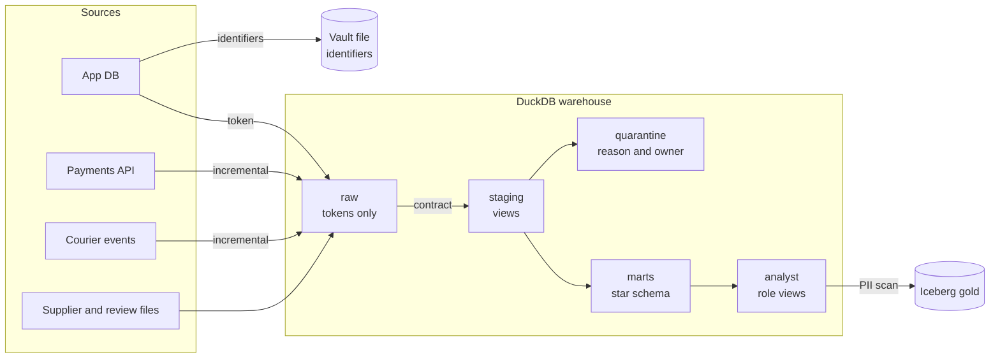

# Qafila Lakehouse

**Team:** Yahya Mohammed Khuzaimi · Abdullah Bin Ghafrah · **Option:** 1 · Qafila Lakehouse
**Course:** Modern Data Engineering, SDAIA Academy ([@SDAIAAcademy](https://github.com/SDAIAAcademy)) · **Fork of:** [SDAIAAcademy/data-engineering](https://github.com/SDAIAAcademy/data-engineering)

**Run it on Colab:** open [`labs/capstone/Qafila_Capstone.ipynb`](labs/capstone/Qafila_Capstone.ipynb) and choose Run all.
**Run it from a terminal:** see [Reproduce](#reproduce). One command, about 30 seconds after setup.
**Read it cell by cell:** [`labs/capstone/Qafila_Walkthrough.ipynb`](labs/capstone/Qafila_Walkthrough.ipynb) builds the whole platform in explained code cells.

> All data is synthetic and generated on your machine. No real person's data is in this repository.

## Problem
Finance needs a revenue number it can trust every morning, and operations needs to know where deliveries miss the 30-minute promise. Both have to work with personal data locked away, because the Personal Data Protection Law (PDPL) applies to Qafila's customers.

**Our platform takes** an app database, a payments API, courier events and supplier files **and produces** tested marts, an operations view, role views and Iceberg gold tables, **refreshed** nightly, **trusted because** a contract stops bad feeds, bad rows go to quarantine with an owner, and every run is checked and logged.

**What the platform found:** product revenue is 6,500,179 SAR. In the week of event data, 35.2% of 5,257 deliveries missed the SLA, and Riyadh is the outlier at 42.4% against about 27–28% in Jeddah and Dammam.

## What we changed in the baseline
| Weakness in the starter kit | What we built | Evidence |
|---|---|---|
| Everything was a full refresh | Payments and courier events load incrementally, with the rows and the cursor in one transaction | `prove_rerun.py`: a re-run leaves 8 tables identical, row for row |
| Quality failures only warned | A blocking contract, three quarantine tables with an owner, a reconciliation test | `prove_rerun.py --block`: a bad feed stops the run and the marts keep their numbers |
| Personal data reached raw tables | Identifiers split into a vault at ingestion, keyed tokens in the warehouse, role views, a PII scan on every run | 0 PII findings across raw, staging, marts, quarantine and analyst views |

## Sources
| Source | Type | Volume | Refresh | Load strategy | Known issues |
|---|---|---|---|---|---|
| App database (`customers`, `orders`, `order_items`, `products`, `stores`) | Database | 7,442 customers, 45,766 orders, 172,545 lines | Nightly | Full snapshot, so hard deletes disappear | Erased customers leave orphan orders; 142 negative quantities; 58 duplicate accounts |
| Payments | HTTP API | 41,785 payments | Nightly | **Incremental**: cursor on `updated_at`, upsert on `payment_id` | Rate limits; 16 non-positive amounts; a new field from 15 September; refunds change old rows |
| Courier events | Events (JSON lines) | 22,518 deliveries of 22,206 events | Nightly | **Incremental**: cursor on `ingest_time`, keyed on `(event_id, ingest_time)` | 312 redelivered events; late events; three time formats |
| Supplier prices | Weekly CSV files | 640 rows | Weekly | Full reload of the folder | Format drift; 4 bad costs; 3 unknown SKUs |
| Reviews | CSV | 3,000 rows | Periodic | Full reload | Free text, so it is scanned for PII |

## Architecture

Every box is a Dagster asset, and every dbt test is an asset check. See [docs/architecture.md](docs/architecture.md) for each decision and its trade-off.

| Stage | Tool | Why |
|---|---|---|
| Ingest | Python with `requests`, DuckDB | The loader is short, and the cursor commits with the rows |
| Store | DuckDB | No server, fast analytics, fits a laptop and Colab |
| Transform | dbt | Tested SQL with lineage worked out from `ref` and `source` |
| Test | dbt tests, ODCS contract, asset checks | Different rules belong at different points |
| Serve | Analyst views, Iceberg gold tables | People read views; other engines read an open table format |
| Orchestrate | Dagster | Asset graph, blocking checks, nightly schedule |
| Observe | `ops.ingest_log`, volume and freshness checks | Every load records what it fetched, added and changed |
| Govern | Vault, HMAC tokens, role views, `ops.data_catalog` | Protection sits at the boundary, not in a later cleanup |

## Data model
| Table | Layer | Grain (one row per...) | Keys | Materialization |
|---|---|---|---|---|
| `marts.fct_order_items` | gold | order line with a positive quantity | `order_line_id`; FKs to all dimensions | incremental |
| `marts.fct_orders` | gold | order | `order_id`; FKs to `dim_customers`, `dim_stores` | table |
| `marts.mart_daily_city_sales` | gold | Riyadh calendar day and city | `order_date`, `city` | table |
| `marts.mart_ops_daily` | gold | Riyadh delivery day and city | `delivery_date`, `city` | table |
| `marts.dim_customers` | gold | customer account, plus unknown member `-1` | `customer_id` | table |
| `marts.dim_products` | gold | product | `product_id` | table |
| `marts.dim_stores` | gold | store | `store_id` | table |
| `marts.dim_date` | gold | calendar day | `date_day` | table |

**Revenue definition:** product revenue is the net amount of delivered order lines with a positive quantity. Delivery fees are a separate number, and the city is the store's city. Delivery fees sit at order grain, so `fct_orders` adds them once and avoids fan-out.

## Quality and observability
Each run reports 58 checks: 53 dbt tests and 5 custom Dagster checks. `dbt build` also runs 3 unit tests and the reconciliation test. Full results: [docs/test_results.md](docs/test_results.md).

| Check | Where | Severity | What it caught |
|---|---|---|---|
| Payments contract | ODCS, Dagster | Blocks | Unknown status in the demo fault |
| Non-positive amounts | ODCS, `qrn_payments` | Quarantine, blocks above 1% | **16 real rows** |
| Raw = clean + quarantined | dbt singular test | Error | Nothing lost |
| Keys and relationships in marts | dbt tests | Error | 0 failures |
| Vault boundary held | Dagster check | Blocks | A false alarm on hex tokens, so we tightened the detector |
| PII in served data | Dagster check | Blocks gold | 0 findings |
| Non-positive quantities | dbt test, `qrn_order_items` | Warn, quarantine | 142 rows |
| Supplier cost and SKU | dbt test, `qrn_supplier_prices` | Warn, quarantine | 7 rows |
| Order total vs. paid | dbt singular test | Warn, owner: finance | 244 orders, down from 258 after quarantine |
| Volume, freshness | Dagster checks | Warn | 0 alerts on the current data |

**Real problem found:** 16 payments had zero or negative amounts. In the baseline, those fed `paid_amount`, and 14 delivered orders showed a negative payment. They now sit in `quarantine.qrn_payments` with a reason and an owner, and no order shows a negative payment.

**Why three outcomes:** block when a wrong number costs more than a late one; quarantine when a few rows are bad and the rest are useful; warn when a person should look but the data is still good.

## Incremental loads and re-runs
| Load | Key | Cursor | Overlap | Why it is safe |
|---|---|---|---|---|
| Payments | `payment_id` | `updated_at`, inclusive | Newest row returns each run | Upsert replaces it with itself |
| Courier events | `(event_id, ingest_time)` | `ingest_time`, inclusive | Newest row returns each run | The key filters it out |
| `fct_order_items` | `order_line_id` | `updated_at`, 3-day look-back | Recent orders reprocess | `delete+insert` on the key |

The rows and the cursor commit in one transaction, so a crash can't leave the cursor ahead of the data. The cursor uses arrival time for events, so a courier who was offline is still picked up.

Evidence from `python capstone/prove_rerun.py`:

| Table | First run | Re-run | Two days later | Re-run identical |
|---|---:|---:|---:|---|
| `raw.payments` | 38,999 | 38,999 | 40,402 | yes |
| `raw.delivery_events` | 10,465 | 10,465 | 16,504 | yes |
| `marts.fct_orders` | 45,766 | 45,766 | 45,766 | yes |
| `marts.mart_ops_daily` | 12 | 12 | 18 | yes |

The later run fetched 1,434 payments: 1,403 new, 30 refunds of old rows, and 1 overlap row. The proof compares a hash of every row, and it caught a real bug: summing doubles depends on row order, so `items_amount` is now rounded.

## Governance note
Full note: [docs/governance.md](docs/governance.md). This is an engineering exercise, not legal advice.

| Column | Classification (NDMO level, illustrative) | Protection | Who can see it raw |
|---|---|---|---|
| `national_id` | Secret | Vault only, HMAC token in the warehouse | Data protection officer |
| `iban` | Secret | Vault only | Data protection officer |
| `full_name`, `email` | Restricted | Vault only; support view | Support |
| `mobile` | Restricted | Vault only; masked in the support view | Nobody by default |
| `person_token` | Restricted | Keyed hash; key outside git | Data engineers |
| `card_last4`, `lat`, `lon`, `courier_id` | Restricted | Stop at staging | Data engineers |
| `city`, `district`, `email_domain` | Restricted | Personal by association; analysts get `city` only | Analysts: `city` |

**Erasure:** deleting a customer in the app removes them from `raw.customers` and the vault on the next nightly snapshot. Their orders stay for finance and point to the unknown member, `-1`. Warehouse backups and old table snapshots need their own retention rule, which is a limitation of this project.

## Reproduce
**Colab:** open [`labs/capstone/Qafila_Capstone.ipynb`](labs/capstone/Qafila_Capstone.ipynb) and run all cells.

**Terminal:**
```bash
git clone https://github.com/vxji/data-engineering.git
cd data-engineering/labs
pip install -r requirements-colab.txt
python capstone/pipeline.py --reset             # one command, end to end
python capstone/prove_rerun.py                  # a re-run changes nothing
python capstone/prove_rerun.py --block          # a bad feed stops the run
dagster dev -f capstone/pipeline.py             # UI, local machines only
```
Data: generated by `labs/prepare_data.py` on the first run. Tested with Python 3.13, DuckDB 1.5 and 2.0, dbt 1.12 and Dagster 1.13. Set `QAFILA_PSEUDO_KEY` to choose the token key; otherwise a random key is created in the run folder, outside git.

## Limitations and next steps
- **Bad row in raw:** a blocked row stays in bronze, and the marts wait until the provider resends it. Validating the batch before it commits would be cleaner.
- **Payments API:** it is the course's local stand-in, so we did not test a real provider's failures.
- **Role views:** DuckDB has no column-level security. The vault file boundary is the real control; a warehouse would use grants and masking policies.
- **Scale:** at 100× the volume, DuckDB on one machine and the full snapshots would break first. We would move to Iceberg tables as the system of record and use change data capture for the app database.
- **Two more weeks:** alert routing to owners, a dashboard, a key rotation procedure, and erasure across backups.
